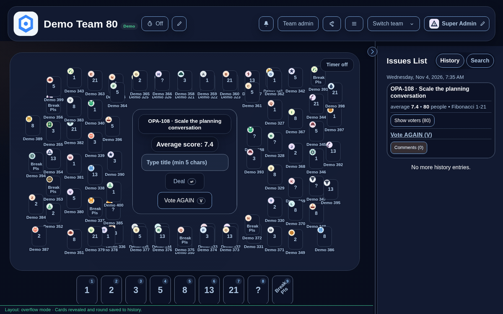
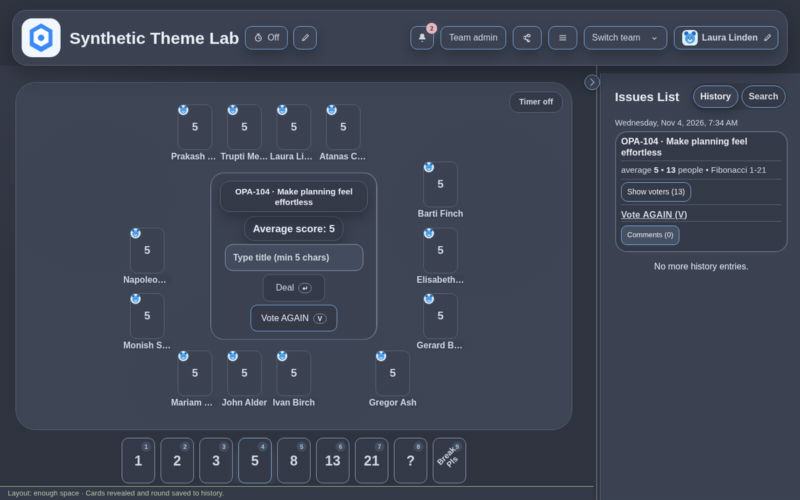
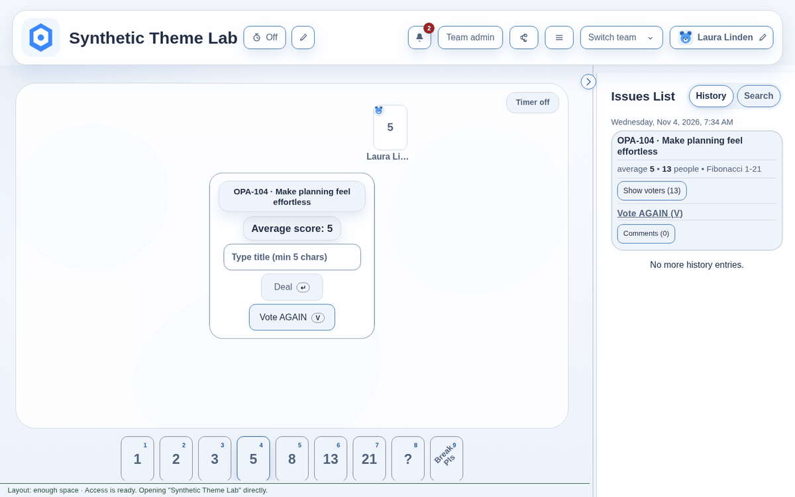

<!--
SPDX-FileCopyrightText: 2026 Atanas G. Rusev
SPDX-License-Identifier: AGPL-3.0-or-later
-->

# OpaVoting Screenshots And Demos

[Project home](../../../README.md) · [Animated demos](../../../README.md#visual-demos) · [Documentation](../../README.md) · [Try the free live demo](https://app.opavotingtool.eu)

This page contains **still images only**. Open an image for its full resolution. The animations in the project README use these stills when the viewer supports `prefers-reduced-motion` picture sources.

## An 80-participant demo board

Start a round, collect votes, reveal the cards and keep the result in history.



[Play GIF](voting-80-participants.gif) · [Voting guide](../../RnD_docs/TEAM_ADMIN_GUIDE.md)

The participants are synthetic demo data. This is a product demonstration; measured capacity is documented separately in the [benchmark summary](../../RnD_docs/PUBLIC_BENCHMARK_SUMMARY.md). The free hosted trial has [workspace quotas](../../../README.md#hosted-trial-collaboration-and-limits).

## Voting, reveal and history

A smaller team completes a voting round with the result visible on the board and in history.



[Play GIF](voting-and-reveal.gif) · [Team administration](../../RnD_docs/TEAM_ADMIN_GUIDE.md)

## Coordinated appearances

The animation shows this same board in light, moderate and dark appearances. The still below shows the default light theme.



[Play GIF](theme-styles.gif) · [All 18 themes and appearance settings](../../RnD_docs/THEMING.md)

## Media Inventory And Refresh

Owner-provided app demonstrations, published on 2026-11-05. The GIFs retain their original bytes, frame timing and looping behavior. All assets are **1200 × 750 pixels**; each animation lasts **9 seconds**. Names and teams shown are demo/synthetic data.

| Asset | GIF size | Frames | Static PNG size | Poster frame (zero-based) |
| --- | ---: | ---: | ---: | ---: |
| `voting-80-participants` | 721,874 bytes | 16 | 443,405 bytes | 15 |
| `voting-and-reveal` | 373,945 bytes | 20 | 274,368 bytes | 19 |
| `theme-styles` | 451,061 bytes | 23 | 209,836 bytes | 0 |

The three GIFs total **1.48 MiB**. They are documentation assets, separate from the application frontend bundle. Static PNGs are lossless extractions of the selected GIF frames. There is no GIF play/pause control in the README; use the static gallery when reduced-motion source selection is unavailable.

To regenerate the PNGs, run the following from the repository root with Python and Pillow installed (a media-maintenance tool only, not an application dependency):

```python
from pathlib import Path
from PIL import Image

media = Path("project_docs/media/demos")
for name, frame in [
    ("voting-80-participants", 15),
    ("voting-and-reveal", 19),
    ("theme-styles", 0),
]:
    with Image.open(media / f"{name}.gif") as image:
        image.seek(frame)
        image.convert("RGB").save(media / f"{name}.png", optimize=True)
```

For new captures, use a disposable local installation with synthetic people/issues and the built-in Demo mode where appropriate. Capture one workflow per short clip, including a readable final result. Exclude real accounts, email addresses, tokens, company data and private settings. Review every frame before publishing; retain a static alternative, descriptive alt text, measured dimensions/duration/size and captions matching what is actually shown. These supplied clips do not include a reproducible recording script; the command above reproduces their static posters.

Project media follows the repository's [license](../../../LICENSE) and [branding guidance](../../../BRANDING.md).
